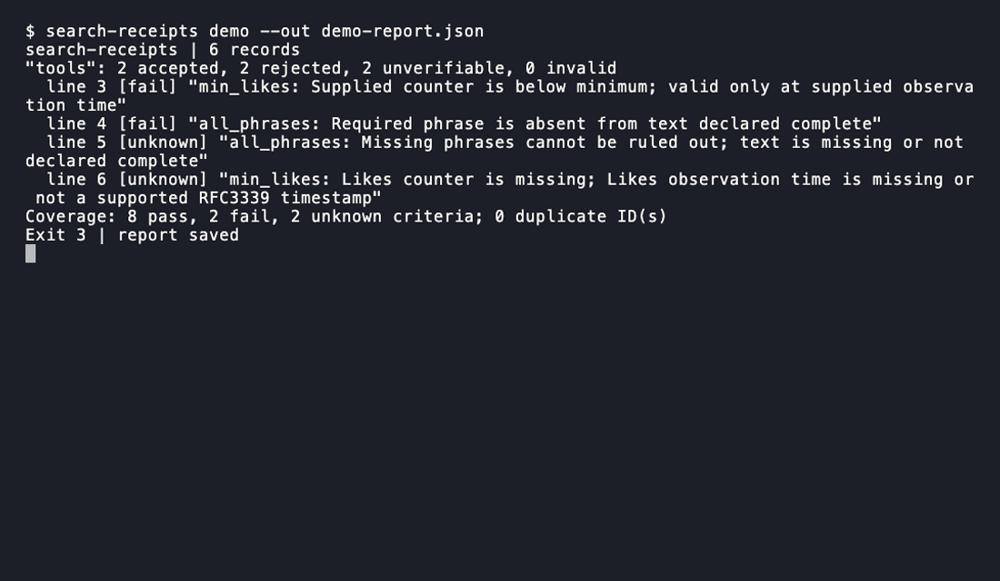

# search-receipts

Know which exported search results meet your filters, and keep a reason for every row you cannot use.

[](https://github.com/itzjk/search-receipts/actions/workflows/ci.yml)
[](LICENSE)



## Quick start

Install with Python 3.9+ and [pipx](https://pipx.pypa.io/stable/installation/):

```sh
pipx install git+https://github.com/itzjk/search-receipts.git
```

Check the bundled synthetic example from any directory:

```sh
search-receipts demo --out report.json
```

The example produces **2 accepted, 2 rejected, 2 unverifiable** rows. Its exit code is `3`, because both rejection and incomplete coverage are present. Open `report.json` to inspect every decision, including the rows that did not pass.

## Features

- Keep per-criterion receipts with observed values, applied rules, and reasons.
- Separate proven mismatches from missing counters, dates, or complete text.
- Apply independent filters to each query without interpreting provider syntax.
- Preserve rejected rows, flag duplicate IDs, and reconcile every input line.
- Run offline with no accounts, service calls, or runtime dependencies.

## Why

A saved query label does not establish that every exported row satisfies it; [X's query guide](https://docs.x.com/x-api/posts/search/integrate/build-a-query) describes its API, rather than every third-party exporter. The [reproducible jq comparison](docs/alternatives.md) demonstrates this project's six-row decision matrix and the additional evidence bookkeeping needed for a reusable receipt.

## How it works

You provide JSONL results and versioned JSON rules keyed by `query_id`. Four criterion types cover a minimum likes count, all literal phrases, any literal phrase, and an optional publication window. Active criteria combine with AND; only `any_phrases` uses OR. Each check returns `pass`, `fail`, or `unknown`. A failed check rejects the row even when another check is unknown; otherwise unknown coverage makes it unverifiable. The report retains source rows, line numbers, both file hashes, effective rules, and per-query totals.

## Usage

Adapt your export using [the input guide](examples/README.md), then run:

```sh
search-receipts check examples/results.jsonl --rules examples/rules.json --out check-report.json
```

| Command or option | Purpose |
| --- | --- |
| `demo --out PATH` | Run the bundled six-row example anywhere |
| `check FILE --rules FILE --out PATH` | Check your local export; write a new report |
| `--max-bytes N` | Cap input bytes; default 10 MiB |
| `--max-records N` | Cap physical input lines; default 100,000 |
| `--max-line-bytes N` | Mark oversized lines invalid; default 1 MiB |
| `--help` | Show command options |

Exit codes are additive flags: `1` means rejected rows, `2` means unknown criteria or duplicate IDs, and `4` means input errors. `0` means every row is verifiable and accepted with no duplicate IDs. For example, `7` preserves all three conditions. See the [report contract](docs/contract.md) for counting, limits, and fatal errors.

## FAQ

**Does it search X or open result URLs?** No. URLs are references stored in the receipt. Original query strings are descriptions, never executable filters.

**Does a missing phrase always fail?** Presence in an excerpt passes. Absence fails only when text is declared complete. Otherwise the phrase check is unknown. Matching uses Unicode NFC, casefold, and collapsed Unicode whitespace, with literal substrings and no synonyms.

**Are likes checked against today's count?** The supplied count is evaluated at its supplied observation time. Missing, negative, or noninteger counts and missing observation times remain unknown.

**Will it modify my export?** Inputs and existing reports stay untouched. Choose a new output path for each run. Duplicate result IDs remain separate records and are flagged, never added together or counted as different people.

## Limitations

- No live verification, provider query parser, regex, semantic matching, or language inference.
- Accepted share is filter adherence, not search precision, recall, or willingness to pay.
- Exported completeness flags and timestamps are assertions from your data source.
- Leap seconds and unknown `-00:00` offsets remain unverifiable.

## Contributing

From a clone, install with `pipx install .`; run `python -m unittest discover -s tests -v` after installing the package in your Python environment with `python -m pip install .`.

## License

[MIT](LICENSE).
